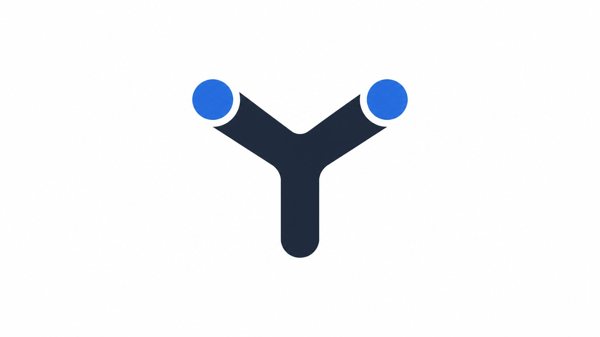

# Y Harness



**Y Harness** is a personal agent harness built on an everything-is-a-plugin architecture powered by [Cordis](https://github.com/cordiverse/cordis). It retains compatibility with the upstream harness and can connect to DeepSeek as a model provider.

This repository is the Y Harness project maintained at [tobenwarrior/y-harness](https://github.com/tobenwarrior/y-harness). It preserves compatibility with established harness packages and adds the ChatGPT subscription provider in `packages/llm/llm-pi-ai`, which runs through the official Codex app, plus the Nous Portal provider and its settings UI in `packages/client/ui-settings-models`.

Documentation: [user guide](docs/user/guide/index.md)

## Developer preview

Y Harness is in _developer preview_ and iterating rapidly. **THERE WILL BE COMPATIBILITY-BREAKING CHANGES.**

Review the [safety notice](SAFETY.md) before running the project.

## Run

### Run from `npm`

Install `Node.js`, then run:

```sh
npx @yharness/cli web
```

The command starts the Web UI at `http://127.0.0.1:3080` by default and opens it in the default browser for a local launch. An SSH launch only prints the host URL because the SSH client or editor owns the local forwarded address. Pass `--no-open` to run the server without opening a browser. See [Web UI guide](docs/user/guide/index.md).

### Run from source

From a repository checkout:

```sh
pnpm install
pnpm run build
pnpm yharness web
```

`pnpm run build` prepares the repository artifacts. `pnpm yharness web` uses those built artifacts without rebuilding. The legacy `dsh` command remains available as a compatibility alias.

## Community and support

- Submit feedback or bug reports through the issue tracker for your Y Harness repository.

## Contributing

See [CONTRIBUTING.md](CONTRIBUTING.md).

## Development

Start with the [development guide](docs/development.md) and [architecture documentation](docs/architecture.md).

`pnpm run dev:web` builds, serves, and rebuilds client bundles on source edits in one terminal, and `make help` lists the matching Make targets for Web and Desktop; the guide's application commands section owns the full table.

For agents, follow [AGENTS.md](AGENTS.md).

## Citation

```bibtex
@misc{y-harness2026,
  title={Y Harness: Everything is a Plugin},
  author={Y Harness contributors},
  year={2026},
  publisher={GitHub},
  howpublished={\url{https://github.com/tobenwarrior/y-harness}},
}
```

## License

[MIT](LICENSE)

Third-party dependencies and their licenses are disclosed in [THIRD_PARTY_NOTICES.md](THIRD_PARTY_NOTICES.md).
